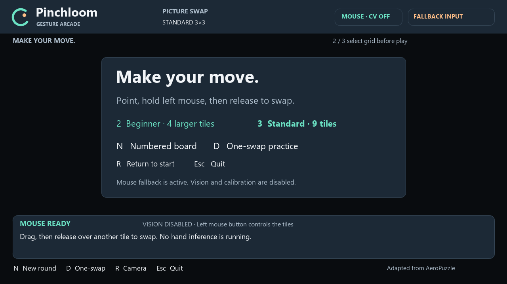
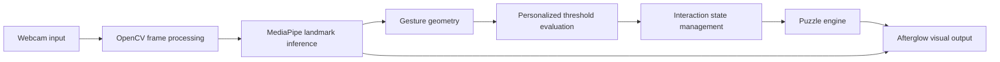
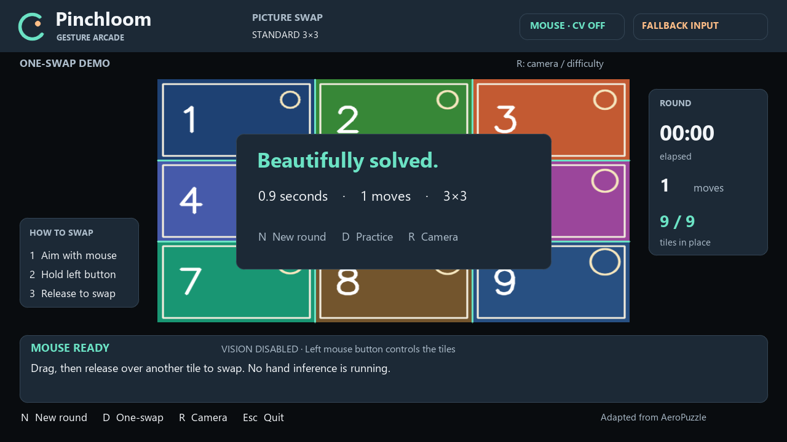

# Pinchloom

### AI-Powered Hand Gesture Recognition and Interactive Puzzle System

**Make your move.** A touch-free picture puzzle with local computer vision and personalized pinch calibration.


[](LICENSE)



*Genuine application output. This capture shows mouse fallback with CV OFF; it is not evidence of hand inference. See the [screenshot provenance](screenshots/README.md).*

## About Pinchloom

Pinchloom translates hand movements into interactive picture-puzzle gameplay. A webcam supplies frames, MediaPipe estimates hand landmarks, and a geometric controller turns thumb–index pinches into tile grabs and releases. Users can calibrate activation and release thresholds to their own hand and pose.

The objective is to demonstrate Edge AI, real-time computer vision and human–computer interaction in a complete local desktop application. Inference runs on the user's CPU. Calibration estimates geometric thresholds from prompted measurements; it does not train a custom CNN or change the pretrained model.

## Features

- Up to two hands with landmark overlays; one controlling hand for calibrated play.
- Pinch to grab, move to a target tile, and open to swap.
- Personalized OPEN/PINCH sampling with hand-size normalization and pixel aspect correction.
- Separate activation/release thresholds, temporal confirmation, pointer filtering and release-to-arm recovery after tracking loss.
- **2×2 Beginner** and **3×3 Standard** boards selected before play.
- Webcam picture capture, shuffled numbered boards and an explicitly labeled one-swap practice preset.
- Time, move count, correct-tile progress, drag feedback and persistent victory display.
- Repeat rounds, the Afterglow Arcade interface, and an explicitly labeled **mouse fallback / CV OFF** mode.
- Local model assets and an offline launcher; no cloud account or GPU is needed for gameplay.

The puzzle swaps arbitrary pairs of tiles. There is no empty sliding cell. [Full feature guide](docs/FEATURES.md).

## Quick start — Windows

Use **64-bit CPython 3.12**; the validated environment uses **3.12.14**. Install Python with the Windows `py` launcher and Git first, then run in PowerShell:

```powershell
git clone https://github.com/DyausG/pinchloom.git
cd pinchloom
py -3.12 -m venv .venv
.\.venv\Scripts\python.exe -m pip install -r requirements.txt
.\.venv\Scripts\python.exe run.py
```

Focus the application window. Choose **2** or **3**. Press **C**, then **O** while holding one open hand, and **K** while touching thumb to index. Each sample phase lasts three seconds. Open the same hand to arm, then press **D** for a one-swap practice round. Swap the first two tiles by pinching, moving, and releasing. Press **N** for a shuffled numbered puzzle or **Space** for a webcam picture.

```powershell
# Camera-free, explicitly labeled mouse mode
.\.venv\Scripts\python.exe run.py --mouse
# Alternate camera and initial grid
.\.venv\Scripts\python.exe run.py --camera 1 --grid 2
# Headless regression, geometry, dataset and real-model smoke checks
.\.venv\Scripts\python.exe scripts/verify_release.py
```

The model is included at its working resource path, so no model download is needed. Internet is needed for cloning/installing dependencies; ordinary gameplay uses local inference. The launcher blocks external Python socket connections within its process. [Complete installation and troubleshooting](docs/INSTALLATION.md).

## Controls

| Input | Action |
|---|---|
| Open hand / pinch / release | Arm controller / grab a tile / swap over target |
| Two index fingertips, then pinch | Frame a webcam region and capture it (region must exceed 100 px in each dimension) |
| `2`, `3` | Select grid at the start screen; press `R` first during a round |
| `C`, `O`, `K` | Start calibration, sample OPEN, sample PINCH |
| `L`, `X` | Load your saved local profile / restore default controller |
| `N`, `D`, `Space` | Shuffled numbered board / one-swap practice / central webcam crop |
| `R`, `Esc` | Return to start / quit |
| Left mouse drag | Tile swap in explicit mouse mode only |

Calibration and photo capture require vision mode. In mouse mode, Space uses a numbered sample board. [Detailed control reference](docs/CONTROLS.md).

## Technology and architecture

| Component | Role |
|---|---|
| Python | Desktop loop, interaction states, CLI and persistence |
| OpenCV 4.10.0.84 | Webcam input, mirroring, image operations and native window |
| MediaPipe 0.10.32 | Pretrained palm detection, 21 landmarks per hand and handedness |
| NumPy 2.2.6 | Arrays, image tiles, quantiles and timing statistics |
| Pillow 12.3.0 | Cached text rendering for the Afterglow UI |

`requirements.txt` retains all 19 pinned packages from the validated environment, including transitive dependencies. No remote inference service is used.



The pipeline mirrors camera input, preserves a clean capture copy, and performs synchronous MediaPipe Tasks inference on frames resized to at most 640 pixels wide. It uses the task's default **IMAGE** mode on successive frames; it does not configure asynchronous LIVE_STREAM inference. [Architecture](docs/ARCHITECTURE.md).

## Methodology

For normalized landmark positions, the personal controller measures the pixel-correct distance between thumb tip **4** and index tip **8**, divided by wrist **0** to middle MCP **9**:

$$r = \frac{\sqrt{[W(x_4-x_8)]^2+[H(y_4-y_8)]^2}}{\sqrt{[W(x_0-x_9)]^2+[H(y_0-y_9)]^2}}.$$

With $a=Q_{10}(r_{OPEN})$, $b=Q_{90}(r_{PINCH})$, and $g=a-b$, accepted calibration requires at least 25 valid samples per pose and $g\ge0.08$. Thresholds are $T_{close}=b+0.35g$ and $T_{release}=b+0.65g$. A nominal 30 ms confirmation delays activation; hysteresis retains a pinch until release. A velocity-adaptive filter smooths the pinch midpoint, and tracking loss cancels an in-progress drag and requires an open hand to rearm.

Frame coordinates map into the board rectangle, then a row and column determine a tile index. Releasing over a valid target swaps two tile references; exact tile-array equality establishes completion. [Equations and state details](docs/METHODOLOGY.md).

## Screenshots



These public images show the main interface and completed gameplay in actual human-operated mouse sessions. Existing live hand-tracking, calibration and webcam-puzzle screenshots contain identifiable personal imagery and are excluded from this public release. No mockups or synthetic hand images substitute for those captures. [Provenance and gallery scope](screenshots/README.md).

## Results and validation

Recorded live validation on **14 October 2026** demonstrated calibrated one-swap wins in **2.900 s (2×2)** and **9.609 s (3×3)**. These are human round-completion times, not inference latency. A final normal camera run processed **652 frames in 65.358 s (9.98 FPS)**, with UI composition p50/p95 **6.67/12.48 ms**. A separate saved-image model test detected a hand in **20/20 repeated runs on the same image**; that is offline file inference, not 20 independent accuracy trials.

The publication checks exercise the preserved five game regression groups, four UI/difficulty groups, geometric validity, controller behavior, the numerical dataset, model integrity and real model inference on a blank frame. Live, file-based and scripted evidence are separated in [VALIDATION.md](docs/VALIDATION.md). There is no measured gesture-recognition accuracy, training result, motion-to-display latency or controlled speedup claim.

## Dataset

**Submission dataset name:** **Pinchloom OPEN/PINCH Calibration Measurements**.

The public sample contains **62 genuine anonymized scalar measurements: 31 OPEN and 31 PINCH**. It supports threshold calculation and reproducibility, not neural-network training or independent accuracy evaluation. Personal profile JSON and raw webcam pixels are excluded. [Dataset documentation](DATASET.md) · [CSV measurements](data/calibration_measurements.csv).

## Uses, limitations and future scope

Pinchloom supports classroom computer-vision demonstrations, local interactive exhibits, HCI prototyping and gesture-interaction portfolios. Low light, occlusion, small or sideways hands and unstable handedness labels can interrupt control. Windows is the validated platform; camera capture uses DirectShow. Personal thresholds depend on the user and capture conditions. Larger studies, controlled latency measurements and broader camera/platform testing are future work. [Limitations](docs/LIMITATIONS.md).

## Documentation

| Guide | Contents |
|---|---|
| [Architecture](docs/ARCHITECTURE.md) | Components, interfaces, data flow and runtime storage |
| [Methodology](docs/METHODOLOGY.md) | Geometry, quantiles, hysteresis, filtering and tile mapping |
| [Features](docs/FEATURES.md) | Supported modes and interface behavior |
| [Installation](docs/INSTALLATION.md) | Setup, pinned versions, launch, tests and troubleshooting |
| [Controls](docs/CONTROLS.md) | Keyboard and gesture reference |
| [Validation](docs/VALIDATION.md) | Evidence, reproducible checks and measurement scope |
| [Limitations](docs/LIMITATIONS.md) | Known constraints and realistic future work |
| [Dataset](DATASET.md) | Collection, numerical sample, use and privacy |

## License and acknowledgments

Application code is [MIT licensed](LICENSE); the pretrained model is Apache-2.0. See [ATTRIBUTION.md](ATTRIBUTION.md) and [third-party license texts](THIRD_PARTY_LICENSES/) for AeroPuzzle, Google MediaPipe and dependency acknowledgments.
